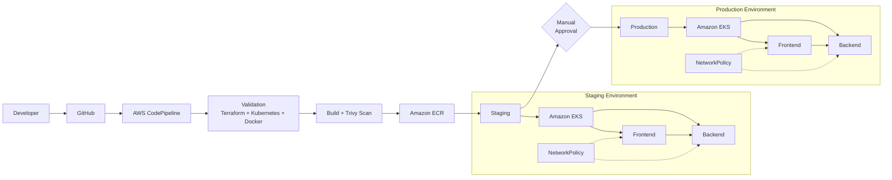

# DevOps / SRE Challenge — INT Chile

## Overview

This project implements a production-oriented DevOps/SRE architecture for a two-tier application consisting of a frontend and backend service.

The solution focuses on:

- Containerization with Docker
- Local orchestration with Docker Compose
- Infrastructure as Code with Terraform
- Kubernetes deployment manifests
- CI/CD automation
- Container and infrastructure security
- Monitoring and observability
- Separation between staging and production environments

The implementation is designed to be reproducible, modular, secure, and suitable for a cloud-native deployment.

---

## Architecture



### Deployment Flow

```text
Developer
    ↓
GitHub
    ↓
AWS CodePipeline
    ↓
Validation
    ↓
Docker Build + Trivy Security Scan
    ↓
Amazon ECR
    ↓
Staging
    ↓
Manual Production Approval
    ↓
Production
```

---

# Repository Structure

```text
.
├── backend/
│   └── application source
│
├── frontend/
│   └── application source
│
├── docker/
│   ├── backend.Dockerfile
│   └── frontend.Dockerfile
│
├── ci/
│   ├── buildspec-validate.yml
│   ├── buildspec-build.yml
│   └── buildspec-deploy.yml
│
├── infra/
│   ├── k8s/
│   │   ├── namespace.yaml
│   │   ├── backend-deployment.yaml
│   │   ├── backend-service.yaml
│   │   ├── backend-hpa.yaml
│   │   ├── frontend-deployment.yaml
│   │   ├── frontend-service.yaml
│   │   ├── frontend-hpa.yaml
│   │   └── network-policy.yaml
│   │
│   └── terraform/
│       ├── main.tf
│       ├── providers.tf
│       ├── versions.tf
│       ├── variables.tf
│       ├── locals.tf
│       ├── outputs.tf
│       │
│       ├── cicd/
│       │   ├── main.tf
│       │   ├── variables.tf
│       │   └── outputs.tf
│       │
│       ├── modules/
│       │   ├── network/
│       │   └── eks/
│       │
│       └── environments/
│           ├── staging/
│           └── production/
│
└── README.md
```

---

# 1. Local Development

## Prerequisites

The following tools are required:

- Docker
- Docker Compose
- Git

Verify Docker:

```bash
docker version
```

Verify Docker Compose:

```bash
docker compose version
```

## Start the Application

From the project root:

```bash
docker compose up --build
```

Run in detached mode:

```bash
docker compose up --build -d
```

Check running containers:

```bash
docker compose ps
```

View logs:

```bash
docker compose logs -f
```

Stop the application:

```bash
docker compose down
```

Remove containers and volumes:

```bash
docker compose down -v
```

---

# 2. Docker

The application uses separate Dockerfiles for the backend and frontend.

```text
docker/
├── backend.Dockerfile
└── frontend.Dockerfile
```

The frontend and backend are independently containerized, allowing them to be built, scanned, versioned, and deployed separately.

## Container Security

The Docker configuration follows these principles:

- Minimal base images
- Multi-stage builds where applicable
- No unnecessary packages
- No secrets embedded in images
- Non-root runtime where supported
- Explicit container configuration
- Vulnerability scanning
- Immutable image tags

Images are tagged using the source commit SHA rather than relying exclusively on `latest`.

Example:

```text
backend:<commit-sha>
frontend:<commit-sha>
```

This provides traceability between a deployed container and its source code.

---

# 3. Docker Compose

Docker Compose provides a reproducible local development environment.

The application is separated into independent services:

```text
Frontend
   │
   ▼
Backend
```

This allows the application to be built and tested locally without requiring a Kubernetes cluster.

Start the complete environment with:

```bash
docker compose up --build
```

---

# 4. Infrastructure as Code

Terraform is used to define the cloud infrastructure.

The Terraform configuration is modularized to separate infrastructure responsibilities.

```text
terraform/
│
├── modules/
│   ├── network/
│   └── eks/
│
├── cicd/
│
└── environments/
    ├── staging/
    └── production/
```

## Network Module

The network module is responsible for the networking layer, including:

- VPC
- Subnets
- Routing
- NAT
- Internet connectivity
- Network-related configuration

## EKS Module

The EKS module is responsible for the Kubernetes infrastructure.

## CI/CD Module

The CI/CD module is responsible for CI/CD-related AWS resources, including:

- Amazon ECR repositories
- AWS CodeBuild projects
- AWS CodePipeline
- S3 artifact storage
- IAM roles and policies

---

# 5. Terraform Environments

The project separates staging and production configuration:

```text
environments/
├── staging/
└── production/
```

This allows the same Terraform modules to be reused while maintaining environment-specific configuration.

## Initialize Terraform

From the Terraform directory:

```bash
cd infra/terraform
```

Initialize Terraform:

```bash
terraform init
```

Format the configuration:

```bash
terraform fmt -recursive
```

Validate the configuration:

```bash
terraform validate
```

## Validate Staging

```bash
cd environments/staging
terraform init -backend=false
terraform validate
```

## Validate Production

```bash
cd environments/production
terraform init -backend=false
terraform validate
```

The challenge does not require the infrastructure to be provisioned into a real AWS account.

---

# 6. Kubernetes

Kubernetes manifests are located under:

```text
infra/k8s/
```

The application is separated into frontend and backend workloads.

## Kubernetes Resources

The project includes:

- Namespace
- Backend Deployment
- Backend Service
- Backend HPA
- Frontend Deployment
- Frontend Service
- Frontend HPA
- NetworkPolicy

## Application Architecture

```text
                 ┌───────────────┐
                 │    Frontend   │
                 └───────┬───────┘
                         │
                         ▼
                 ┌───────────────┐
                 │    Backend    │
                 └───────────────┘
```

Frontend and backend are deployed independently, allowing independent scaling and rollout.

---

# 7. Horizontal Pod Autoscaling

Horizontal Pod Autoscalers are configured for the application workloads.

HPA allows Kubernetes to adjust the number of replicas according to resource utilization.

This provides a foundation for handling changes in workload without manually changing replica counts.

---

# 8. Kubernetes Security

The Kubernetes configuration follows a defense-in-depth approach.

## Network Policies

NetworkPolicy resources restrict unnecessary communication between workloads.

The intended application flow is:

```text
External Traffic
       │
       ▼
   Frontend
       │
       ▼
   Backend
```

Unnecessary east-west communication is restricted.

## Container Security

The workloads are designed to follow Kubernetes security best practices, including:

- Non-root containers where supported
- Restricted Linux capabilities
- Read-only filesystems where compatible
- Resource requests and limits
- Explicit container configuration
- No hard-coded credentials

---

# 9. CI/CD

The CI/CD architecture uses AWS CodePipeline and AWS CodeBuild.

The pipeline is divided into distinct stages:

```text
Source
   │
   ▼
Validation
   │
   ▼
Build + Security Scan
   │
   ▼
Staging
   │
   ▼
Manual Approval
   │
   ▼
Production
```

## Validation

The validation stage checks:

- Terraform formatting
- Terraform configuration
- Kubernetes manifests
- Dockerfiles

Security scanning is incorporated into the pipeline.

## Build

The build stage:

1. Authenticates with Amazon ECR
2. Builds the backend image
3. Builds the frontend image
4. Scans the images using Trivy
5. Pushes the images to Amazon ECR

Images are tagged using the source commit SHA.

## Staging

The staging stage represents deployment to the staging environment.

The deployment process applies the Kubernetes resources required by the application.

## Production

Production deployment is protected by a manual approval stage.

This creates an explicit human control point before production promotion.

---

# 10. Security

Security is incorporated throughout the development and deployment lifecycle.

## Source Code

Secrets should never be committed to Git.

Sensitive configuration should be provided through:

- Environment variables
- Secret management systems
- CI/CD configuration
- Kubernetes Secrets where appropriate

## Docker

Container images are scanned for vulnerabilities using Trivy.

The pipeline is configured to identify high and critical vulnerabilities according to the configured scanning policy.

## Terraform

Infrastructure is defined as code and can be reviewed alongside application changes.

IAM permissions are scoped to the resources required by CI/CD components where practical.

## AWS

The architecture uses:

- IAM roles instead of long-lived credentials where possible
- ECR image scanning
- S3 public access blocking
- S3 versioning
- Server-side encryption
- Separate staging and production resources

## Kubernetes

The architecture includes:

- NetworkPolicy
- Resource requests and limits
- Container security settings
- Namespace isolation

---

# 11. Observability

The solution considers the three primary observability signals:

```text
Metrics
Logs
Traces
```

## Metrics

Recommended application and infrastructure metrics include:

- CPU utilization
- Memory utilization
- Pod restarts
- Request rate
- Request latency
- Error rate
- Availability

## Logs

Application and container logs should be collected centrally.

Useful sources include:

- Application logs
- Container logs
- Kubernetes events
- Infrastructure logs

## Alerts

Operational alerts should focus on actionable conditions such as:

- High error rate
- Increased latency
- Pod crash loops
- High resource utilization
- Deployment failures
- Service unavailability

---

# 12. Reliability

The architecture incorporates several reliability practices:

- Kubernetes Deployments
- Health checks
- Horizontal Pod Autoscaling
- Resource requests and limits
- Independent frontend/backend scaling
- Immutable container versions
- Staging before production
- Manual production approval
- Infrastructure as Code

These mechanisms provide a structured path from source code to production and reduce the risk of uncontrolled deployments.

---

# 13. Deployment Strategy

The intended deployment flow is:

```text
Developer
    │
    ▼
Git Commit
    │
    ▼
CI/CD Validation
    │
    ├── Terraform validation
    ├── Kubernetes validation
    ├── Dockerfile validation
    └── Security scanning
    │
    ▼
Container Build
    │
    ▼
Trivy Scan
    │
    ▼
Amazon ECR
    │
    ▼
Staging
    │
    ▼
Manual Approval
    │
    ▼
Production
```

Using the commit SHA as the image version allows a deployment to be traced back to a specific source revision.

---

# 14. Security and Operational Trade-offs

Several design decisions balance security, complexity, and maintainability.

## Separate Environments

Staging and production are separated to reduce the risk of directly promoting untested changes.

## Manual Production Approval

The production approval stage adds a human control point.

This introduces some deployment latency but provides an additional safeguard against unintended production deployments.

## Immutable Image Tags

Using commit SHA tags improves traceability and rollback compared with relying exclusively on `latest`.

## Security Scanning in CI/CD

Scanning during the build process provides earlier feedback and can prevent images with configured high or critical vulnerabilities from progressing through the pipeline.

## Kubernetes NetworkPolicy

Network policies reduce unnecessary service-to-service communication and provide an additional security boundary.

---

# 15. Validation Checklist

Before submitting the challenge, verify:

- [ ] Backend starts successfully
- [ ] Frontend starts successfully
- [ ] Docker Compose works
- [ ] Dockerfiles are valid
- [ ] Terraform is formatted
- [ ] Terraform validation passes
- [ ] Staging Terraform configuration is valid
- [ ] Production Terraform configuration is valid
- [ ] Kubernetes manifests are present
- [ ] NetworkPolicy is present
- [ ] HPA resources are present
- [ ] CI/CD buildspecs are present
- [ ] ECR repositories are defined
- [ ] Container security scanning is configured
- [ ] Production approval is configured
- [ ] No secrets are committed
- [ ] README documentation is complete

---

# 16. Key Design Principles

The implementation follows these principles:

1. **Infrastructure as Code** — infrastructure is defined using Terraform.
2. **Automation** — repetitive build and deployment tasks are automated.
3. **Security by Default** — security checks are incorporated into the pipeline.
4. **Least Privilege** — IAM permissions are limited to required actions where practical.
5. **Immutable Deployments** — container versions are tied to source commits.
6. **Environment Separation** — staging and production are independently configured.
7. **Defense in Depth** — security is applied across source, container, infrastructure, and Kubernetes layers.
8. **Observability** — metrics, logs, and actionable alerts are considered part of the operational design.
9. **Reproducibility** — the application can be started locally using Docker Compose.
10. **Human Control for Production** — production promotion requires explicit approval.

---

# Conclusion

This project demonstrates a complete DevOps/SRE workflow from source code through containerization, infrastructure as code, security validation, CI/CD, and Kubernetes deployment.

The architecture is modular so that individual components can be changed independently while maintaining a consistent deployment process across staging and production.
